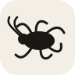
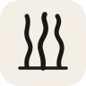
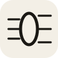

# Nature-Inspired Optimisation

My goal with this project is to celebrate optimization strategies from our blue planet. I see our collective 
documentation of strategies from nature as a heritage we can all observe, document, and celebrate together. 
My hope is we can use these algorithms as a meeting ground for refining our collective understanding.

Every method below is implemented. Continuous optimizers share one contract: construct with an objective, bounds, population size, and seed, then call `run(iterations)` to minimise. Short names live in `nio.OPTIMIZERS`. Boids and self-propelled particles are movement models. Ant colony and river formation dynamics also run as grid pathfinders.

Each silhouette links to the paper that introduced the method.

<table>
<tr><td align="center" valign="top"><a href="https://doi.org/10.7551/mitpress/1090.001.0001"><br><b>GA</b><br><sub>Genetic Algorithm</sub><br><code>GeneticAlgorithm</code></a></td><td align="center" valign="top"><a href="https://doi.org/10.1109/ICNN.1995.488968"><br><b>PSO</b><br><sub>Particle Swarm</sub><br><code>ParticleSwarmOptimization</code></a></td><td align="center" valign="top"><a href="https://doi.org/10.1109/TEVC.2002.1011539"><br><b>AIS</b><br><sub>Artificial Immune System</sub><br><code>ClonalSelection</code></a></td><td align="center" valign="top"><a href="https://doi.org/10.1145/37402.37406"><br><b>Boids</b><br><sub>Boids</sub><br><code>boids_step</code></a></td><td align="center" valign="top"><a href="https://web.archive.org/web/20060926195738id_/http://www.densis.fee.unicamp.br/~moscato/papers/bigone.ps"><br><b>MA</b><br><sub>Memetic Algorithm</sub><br><code>MemeticAlgorithm</code></a></td><td align="center" valign="top"><a href="https://doi.org/10.1109/3477.484436"><br><b>ACO</b><br><sub>Ant Colony</sub><br><code>AntColonyOptimization</code></a></td></tr>
<tr><td align="center" valign="top"><a href="https://doi.org/10.1142/9789814534116"><br><b>CA</b><br><sub>Cultural Algorithm</sub><br><code>CulturalAlgorithm</code></a></td><td align="center" valign="top"><a href="https://doi.org/10.1103/PhysRevLett.75.1226"><br><b>SPP</b><br><sub>Self-propelled Particles</sub><br><code>vicsek_step</code></a></td><td align="center" valign="top"><a href="https://doi.org/10.1023/A:1008202821328"><br><b>DE</b><br><sub>Differential Evolution</sub><br><code>DifferentialEvolution</code></a></td><td align="center" valign="top"><a href="https://doi.org/10.1109/MCS.2002.1004010"><br><b>BFO</b><br><sub>Bacterial Foraging</sub><br><code>BacterialForagingOptimization</code></a></td><td align="center" valign="top"><a href="https://doi.org/10.1109/CEC.2001.934391"><br><b>MHB</b><br><sub>Marriage in Honey Bees</sub><br><code>MarriageInHoneyBees</code></a></td><td align="center" valign="top"><a href="http://en.cnki.com.cn/Article_en/CJFDTOTAL-XTLL200211006.htm"><br><b>AFS</b><br><sub>Artificial Fish School</sub><br><code>ArtificialFishSchool</code></a></td></tr>
<tr><td align="center" valign="top"><a href="https://doi.org/10.1109/4235.985689"><br><b>BC</b><br><sub>Bacterial Chemotaxis</sub><br><code>BacterialChemotaxis</code></a></td><td align="center" valign="top"><a href="https://doi.org/10.1109/icmlc.2002.1174487"><br><b>SCO</b><br><sub>Social Cognitive Optimization</sub><br><code>SocialCognitiveOptimization</code></a></td><td align="center" valign="top"><a href="https://abc.erciyes.edu.tr/pub/tr06_2005.pdf"><br><b>ABC</b><br><sub>Artificial Bee Colony</sub><br><code>ArtificialBeeColony</code></a></td><td align="center" valign="top"><a href="https://doi.org/10.1007/s11721-008-0021-5"><br><b>GSO</b><br><sub>Glowworm Swarm</sub><br><code>GlowwormSwarmOptimization</code></a></td><td align="center" valign="top"><a href="https://doi.org/10.1016/j.jfranklin.2006.06.001"><br><b>HBMO</b><br><sub>Honey-Bee Mating</sub><br><code>HoneyBeeMatingOptimization</code></a></td><td align="center" valign="top"><a href="https://doi.org/10.1016/j.ecoinf.2006.07.003"><br><b>IWO</b><br><sub>Invasive Weed</sub><br><code>InvasiveWeedOptimization</code></a></td></tr>
<tr><td align="center" valign="top"><a href="https://doi.org/10.1080/03052150500384759"><br><b>SFLA</b><br><sub>Shuffled Frog Leaping</sub><br><code>ShuffledFrogLeaping</code></a></td><td align="center" valign="top"><a href="https://doi.org/10.1016/j.sbspro.2012.01.033"><br><b>IWD-CO</b><br><sub>Intelligent Water Drops</sub><br><code>IWDCO</code></a></td><td align="center" valign="top"><a href="https://doi.org/10.1007/978-3-540-73554-0_16"><br><b>RFD</b><br><sub>River Formation Dynamics</sub><br><code>RiverFormationDynamics</code></a></td><td align="center" valign="top"><a href="https://doi.org/10.1109/TEVC.2008.919004"><br><b>BBO</b><br><sub>Biogeography-Based Optimization</sub><br><code>BiogeographyBasedOptimization</code></a></td><td align="center" valign="top"><a href="https://doi.org/10.1109/SIS.2008.4668317"><br><b>RIO</b><br><sub>Roach Infestation</sub><br><code>RoachInfestationOptimization</code></a></td><td align="center" valign="top"><a href="https://doi.org/10.1109/91.797983"><br><b>BEA</b><br><sub>Bacterial Evolutionary Algorithm</sub><br><code>BacterialEvolutionaryAlgorithm</code></a></td></tr>
<tr><td align="center" valign="top"><a href="https://doi.org/10.1109/NABIC.2009.5393690"><br><b>CS</b><br><sub>Cuckoo Search</sub><br><code>CuckooSearch</code></a></td><td align="center" valign="top"><a href="https://arxiv.org/abs/1003.1466"><br><b>FA</b><br><sub>Firefly Algorithm</sub><br><code>FireflyAlgorithm</code></a></td><td align="center" valign="top"><a href="https://doi.org/10.1016/j.ins.2009.03.004"><br><b>GSA</b><br><sub>Gravitational Search</sub><br><code>GravitationalSearchAlgorithm</code></a></td><td align="center" valign="top"><a href="https://arxiv.org/abs/1004.4170"><br><b>BA</b><br><sub>Bat Algorithm</sub><br><code>BatAlgorithm</code></a></td><td align="center" valign="top"><a href="https://arxiv.org/abs/2112.10318"><br><b>PEOA</b><br><sub>Philippine Eagle</sub><br><code>PhilippineEagleOptimization</code></a></td><td align="center" valign="top"><a href="https://doi.org/10.1007/978-3-642-13495-1_44"><br><b>FWA</b><br><sub>Fireworks Algorithm</sub><br><code>FireworksAlgorithm</code></a></td></tr>
<tr><td align="center" valign="top"><a href="https://doi.org/10.1016/j.matcom.2023.03.004"><br><b>APA</b><br><sub>Altruistic Population</sub><br><code>AltruisticPopulationAlgorithm</code></a></td><td align="center" valign="top"><a href="https://doi.org/10.20965/jaciii.2011.p1116"><br><b>SDA</b><br><sub>Spiral Dynamics</sub><br><code>SpiralDynamicAlgorithm</code></a></td><td align="center" valign="top"><a href="https://repository.essex.ac.uk/9974/1/paper.pdf"><br><b>Strawberry</b><br><sub>Strawberry Algorithm</sub><br><code>StrawberryAlgorithm</code></a></td><td align="center" valign="top"><a href="https://doi.org/10.1016/j.asoc.2015.03.003"><br><b>AAA</b><br><sub>Artificial Algae</sub><br><code>ArtificialAlgaeAlgorithm</code></a></td><td align="center" valign="top"><a href="https://doi.org/10.1155/2012/698057"><br><b>BCO</b><br><sub>Bacterial Colony</sub><br><code>BacterialColonyOptimization</code></a></td><td align="center" valign="top"><a href="https://arxiv.org/abs/1312.5673"><br><b>FPA</b><br><sub>Flower Pollination</sub><br><code>FlowerPollinationAlgorithm</code></a></td></tr>
<tr><td align="center" valign="top"><a href="https://doi.org/10.1016/j.cnsns.2012.05.010"><br><b>KH</b><br><sub>Krill Herd</sub><br><code>KrillHerd</code></a></td><td align="center" valign="top"><a href="https://doi.org/10.1016/j.compstruc.2012.07.010"><br><b>WCA</b><br><sub>Water Cycle</sub><br><code>WaterCycleAlgorithm</code></a></td><td align="center" valign="top"><a href="https://doi.org/10.1109/FUZZ-IEEE.2015.7337957"><br><b>PPSO</b><br><sub>Proactive Particle Swarm</sub><br><code>PPSO</code></a></td><td align="center" valign="top"><a href="https://doi.org/10.1007/s00521-015-1920-1"><br><b>DA</b><br><sub>Dragonfly Algorithm</sub><br><code>DragonflyAlgorithm</code></a></td><td align="center" valign="top"><a href="https://doi.org/10.1016/j.ins.2012.08.023"><br><b>BHA</b><br><sub>Black Hole</sub><br><code>BlackHoleAlgorithm</code></a></td><td align="center" valign="top"><a href="https://www.ijser.org/onlineResearchPaperViewer.aspx?Cuttlefish-Algorithm-A-Novel-Bio-Inspired-Optimization-Algorithm.pdf"><br><b>CFA</b><br><sub>Cuttlefish Algorithm</sub><br><code>CuttlefishAlgorithm</code></a></td></tr>
<tr><td align="center" valign="top"><a href="https://doi.org/10.1016/j.asoc.2012.03.068"><br><b>GBMO</b><br><sub>Gases Brownian Motion</sub><br><code>GasesBrownianMotionOptimization</code></a></td><td align="center" valign="top"><a href="https://doi.org/10.1016/j.asoc.2012.11.026"><br><b>MBA</b><br><sub>Mine Blast</sub><br><code>MineBlastAlgorithm</code></a></td><td align="center" valign="top"><a href="https://repository.essex.ac.uk/9974/1/paper.pdf"><br><b>PPA</b><br><sub>Plant Propagation</sub><br><code>PlantPropagationAlgorithm</code></a></td><td align="center" valign="top"><a href="https://doi.org/10.1016/j.eswa.2013.05.041"><br><b>SSO</b><br><sub>Social Spider</sub><br><code>SocialSpiderOptimization</code></a></td><td align="center" valign="top"><a href="https://doi.org/10.1007/s12293-013-0128-0"><br><b>SMO</b><br><sub>Spider Monkey</sub><br><code>SpiderMonkeyOptimization</code></a></td><td align="center" valign="top"><a href="https://doi.org/10.1007/s00521-013-1433-8"><br><b>AMO</b><br><sub>Animal Migration</sub><br><code>AnimalMigrationOptimization</code></a></td></tr>
<tr><td align="center" valign="top"><a href="https://doi.org/10.1007/s00521-019-04452-x"><br><b>AEA</b><br><sub>Artificial Ecosystem</sub><br><code>ArtificialEcosystemAlgorithm</code></a></td><td align="center" valign="top"><a href="https://doi.org/10.1016/j.cnsns.2013.08.027"><br><b>BMO</b><br><sub>Bird Mating</sub><br><code>BirdMatingOptimizer</code></a></td><td align="center" valign="top"><a href="https://doi.org/10.1016/j.eswa.2014.05.009"><br><b>FOA</b><br><sub>Forest Optimization</sub><br><code>ForestOptimizationAlgorithm</code></a></td><td align="center" valign="top"><a href="https://doi.org/10.1016/j.advengsoft.2013.12.007"><br><b>GWO</b><br><sub>Grey Wolf Optimizer</sub><br><code>GreyWolfOptimizer</code></a></td><td align="center" valign="top"><a href="https://doi.org/10.1016/j.jcde.2015.06.003"><br><b>LOA</b><br><sub>Lion Optimization</sub><br><code>LionOptimizationAlgorithm</code></a></td><td align="center" valign="top"><a href="https://doi.org/10.1016/j.cor.2014.10.011"><br><b>OIO</b><br><sub>Optics Inspired Optimization</sub><br><code>OpticsInspiredOptimization</code></a></td></tr>
<tr><td align="center" valign="top"><a href="https://doi.org/10.1007/s00500-014-1520-5"><br><b>RROA</b><br><sub>Raven Roosting</sub><br><code>RavenRoostingOptimization</code></a></td><td align="center" valign="top"><a href="https://doi.org/10.1016/j.cor.2014.10.008"><br><b>WWO</b><br><sub>Water Wave</sub><br><code>WaterWaveOptimization</code></a></td><td align="center" valign="top"><a href="https://doi.org/10.1155/2012/638275"><br><b>CAB</b><br><sub>Collective Animal Behavior</sub><br><code>CollectiveAnimalBehavior</code></a></td><td align="center" valign="top"><a href="https://doi.org/10.1016/j.eswa.2011.04.126"><br><b>ACROA</b><br><sub>Artificial Chemical Reaction</sub><br><code>ArtificialChemicalReactionOptimization</code></a></td><td align="center" valign="top"><a href="https://doi.org/10.3906/elk-1307-123"><br><b>BOA</b><br><sub>Bull Optimization</sub><br><code>BullOptimizationAlgorithm</code></a></td><td align="center" valign="top"><a href="https://doi.org/10.1109/iscbi.2015.8"><br><b>EHO</b><br><sub>Elephant Herding</sub><br><code>ElephantHerdingOptimization</code></a></td></tr>
</table>

`AntColonyPath` is the grid pathfinder beside the continuous ant colony. The strawberry and plant-propagation marks open the same paper.

# Publications

* [Algorithms](http://www.mdpi.com/journal/algorithms)
* [Journal of Algorithms](https://www.sciencedirect.com/journal/journal-of-algorithms)
* [Swarm and Evolutionary Computation](https://www.journals.elsevier.com/swarm-and-evolutionary-computation/)
* [International Journal of Swarm Intelligence and Evolutionary Computation](https://www.omicsonline.org/swarm-intelligence-evolutionary-computation.php#)
* [Swarm Intelligence](https://link.springer.com/journal/11721)
* [Evolutionary Intelligence](http://www.springer.com/engineering/computational+intelligence+and+complexity/journal/12065)

# Conferences

* [GECCO](http://gecco-2018.sigevo.org/index.html/tiki-index.php?page=HomePage)

# Research teams

* [Tübingen](http://www.ra.cs.uni-tuebingen.de/links/genetisch/welcome_e.html)


## Getting Started

Install the package locally. Once installed you can import `nio` from anywhere on your system.


### EXAMPLE: Using the IWD-CO Algorithm

The Intelligent Water Drops - Continuous Optimization (IWD-CO) algorithm simulates water drops flowing through a landscape, where drops move toward areas with less soil (better solutions). The implementation includes multiple liquid and soil types, each with distinct physical properties that affect optimization behavior.

**Basic usage:**

```python
from nio import IWDCO

optimizer = IWDCO(bounds=[(-5.12, 5.12)] * 5, population_size=40, seed=42)
best_position, best_value = optimizer.run(iterations=200)
print(best_value)
```

**Using specific material types:**

The algorithm supports 6 liquid types (H2O, OIL, ALCOHOL, GLYCEROL, MERCURY, HONEY) and 6 soil types (SAND, CLAY, SILT, GRAVEL, LOAM, PEAT), each with different properties affecting velocity, soil pickup, and deposition:

```python
from nio import IWDCO, LiquidType, SoilType

# Use specific liquid and soil types
optimizer = IWDCO(
    bounds=[(-5.12, 5.12)] * 5,
    population_size=40,
    liquid_types=[LiquidType.OIL, LiquidType.ALCOHOL, LiquidType.HONEY],
    soil_types=[SoilType.SAND, SoilType.CLAY, SoilType.LOAM],
    liquid_distribution="uniform",  # or "random"
    seed=42
)
best_position, best_value = optimizer.run(iterations=200)
```

**Material properties:**
- **Liquid types** affect velocity (viscosity, velocity multiplier) and soil carrying capacity
- **Soil types** affect movement resistance, pickup difficulty, deposition rate, and erosion rate
- Different combinations create diverse optimization behaviors

### EXAMPLE: Using the Water Cycle Algorithm

The Water Cycle Algorithm (WCA) simulates the natural water cycle process, where streams flow toward rivers, rivers flow toward the sea, and evaporation/raining processes provide exploration.

**Basic usage:**

```python
from nio import WaterCycleAlgorithm

optimizer = WaterCycleAlgorithm(
    bounds=[(-5.12, 5.12)] * 5,
    population_size=40,
    num_rivers=4,
    seed=42
)
best_position, best_value = optimizer.run(iterations=200)
```

**Algorithm features:**
- **Sea**: Best solution (global best)
- **Rivers**: Better solutions that streams flow toward
- **Streams**: Population members that flow toward rivers or sea
- **Flow process**: Streams and rivers move toward better solutions
- **Evaporation**: When streams/rivers get close to sea, they evaporate
- **Raining**: Evaporated water creates new random solutions for exploration

**Parameters:**
- `num_rivers`: Number of rivers (better solutions), typically 3-5
- `evaporation_rate`: Base probability of evaporation (controls exploration)
- `max_evaporation_distance`: Maximum distance for evaporation to occur
- `flow_rate`: Base rate at which water bodies move toward targets

**Using specific liquid types:**

The algorithm supports 7 liquid types (FRESH_WATER, SALTWATER, DISTILLED_WATER, HOT_WATER, COLD_WATER, HEAVY_WATER, STEAM), each with different properties affecting flow speed, evaporation rate, and boiling point:

```python
from nio import WaterCycleAlgorithm, WCA_LiquidType

# Use specific liquid types
optimizer = WaterCycleAlgorithm(
    bounds=[(-5.12, 5.12)] * 5,
    population_size=40,
    num_rivers=4,
    liquid_types=[WCA_LiquidType.HOT_WATER, WCA_LiquidType.STEAM, WCA_LiquidType.FRESH_WATER],
    liquid_distribution="uniform",  # or "random"
    seed=42
)
best_position, best_value = optimizer.run(iterations=200)
```

**Liquid properties:**
- **Flow speed**: Affects how fast water bodies move toward targets (STEAM is fastest, HEAVY_WATER is slowest)
- **Evaporation rate**: Affects probability of evaporation (HOT_WATER/STEAM evaporate faster, COLD_WATER slower)
- **Boiling point**: Affects distance threshold for evaporation (lower = evaporates at greater distances)
- **Density**: Affects flow behavior

Different liquid types create diverse optimization behaviors - fast-flowing liquids like STEAM explore quickly, while slower liquids like HEAVY_WATER provide more controlled convergence.


## Train

`TrainingEnv` is a bounded search episode. Each step proposes a point, and the reward is how much the best value improved. `reset` and `step` return observation, reward, terminated, truncated, and info. Nothing here depends on Gymnasium.

Any short name in the algorithm list can take the episode. A linear policy can be trained on the same loop and stored as JSON.

```python
from nio.rl import TrainingEnv, rollout, train_policy

env = TrainingEnv(seed=0)
total, info = rollout(env, "gwo")
policy, returns = train_policy(env, episodes=8, seed=1)
```

```bash
python examples/train_demo.py
```

## Contributing

Contributions are welcome across algorithms, benchmarks, documentation, and examples.

- Open an issue first for substantial feature work to align on scope.
- Fork the repo and create a focused branch per change.
- Add or update tests and examples where practical.
- Keep algorithm references (paper links/citations) in the README or module docstrings.
- Open a pull request with a clear summary of motivation, approach, and validation steps.

## License

This project is licensed under the MIT License.

Copyright (c) 2018-present Nature-Inspired Optimisation contributors.
